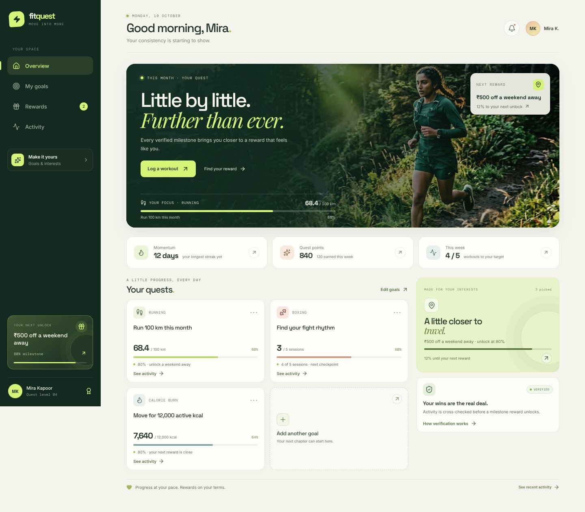
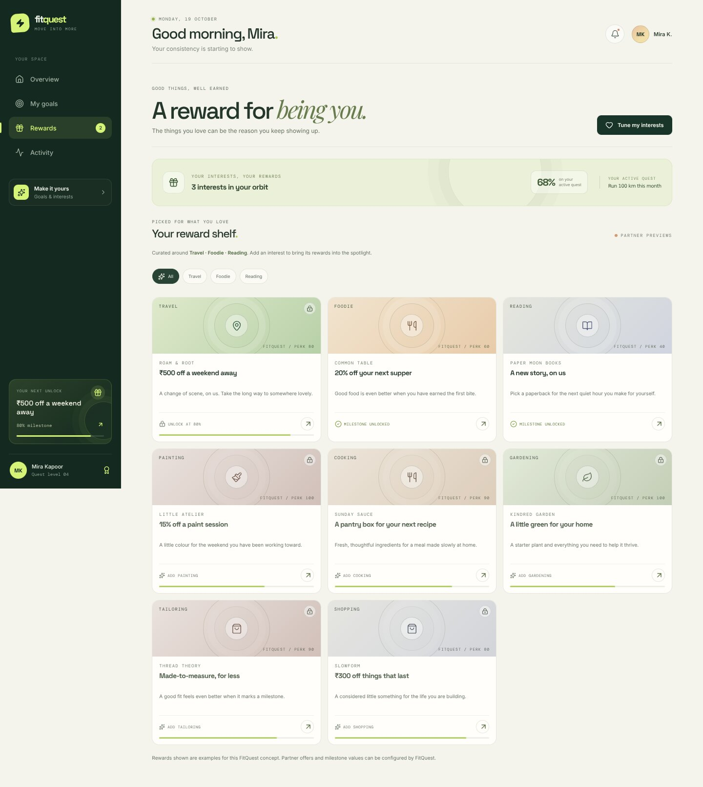
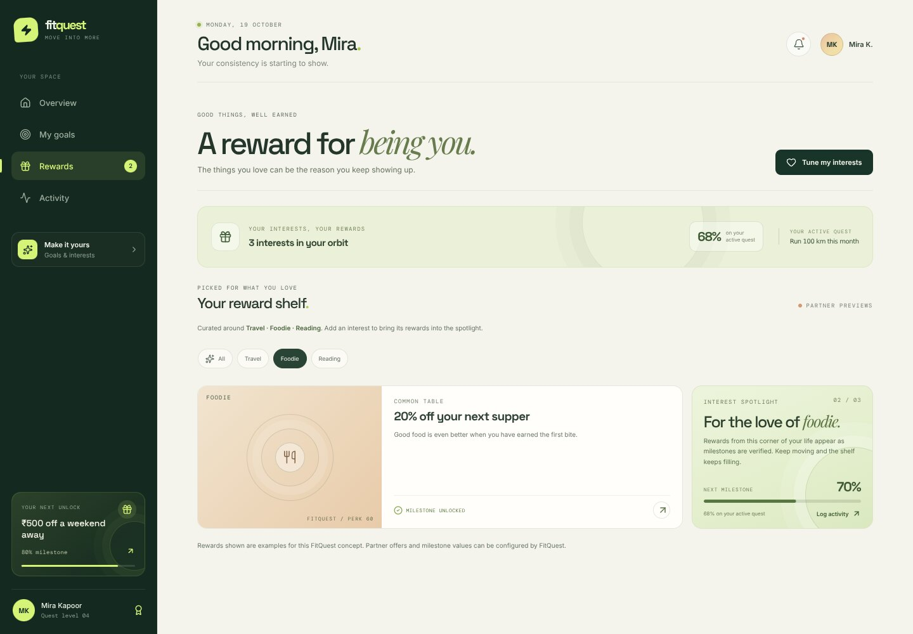
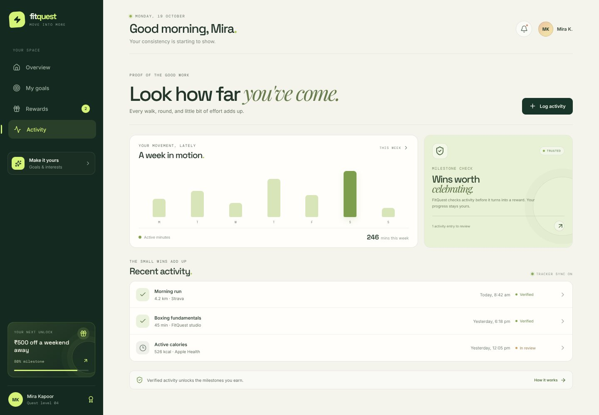
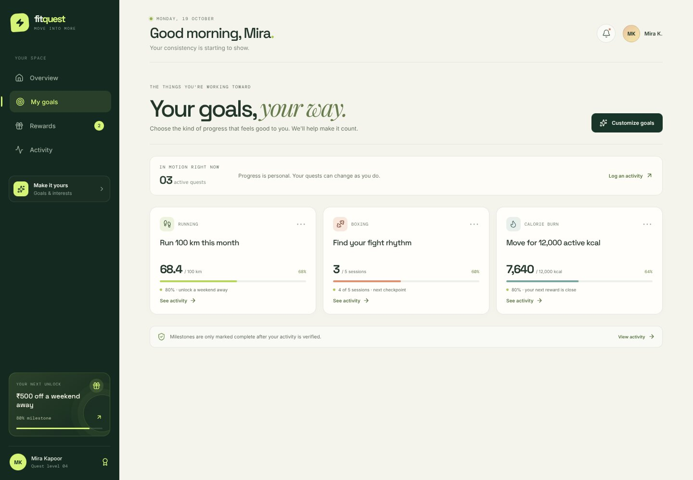
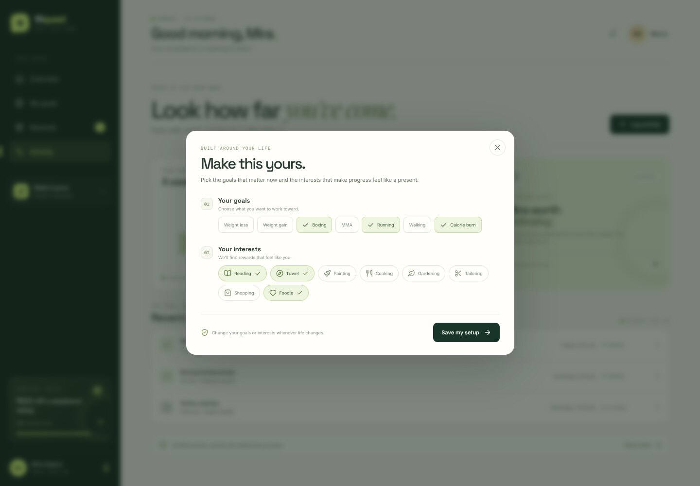
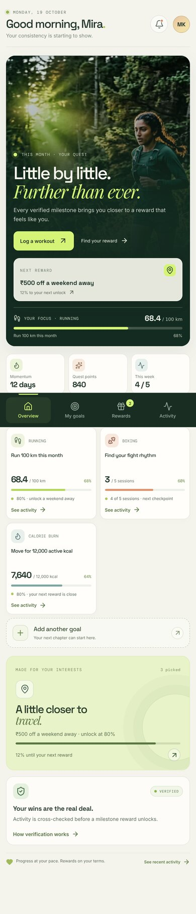

# FitQuest — move into more

FitQuest is a concept product UI for **goal gamification through personal interests**.
Members choose the goals they care about (weight loss, weight gain, boxing, MMA,
running, walking, calorie burn) and the interests that reward them (reading,
travel, painting, cooking, gardening, tailoring, shopping, foodie). Verified
milestones unlock partner vouchers and offers that feel personal.

This repository contains a fully interactive, front-end prototype built with
React + TypeScript + Vite.

## The idea in one line

> Set the goal. Log the effort. Get verified. Unlock a reward from something you already love.

## Screens

| | |
|---|---|
|  |  |
| Overview — hero quest, momentum, next unlock | Rewards — partner shelf with locked/unlocked milestones |
|  |  |
| Rewards filtered by an interest, with spotlight | Activity — weekly movement, verification and log |

| | | |
|---|---|---|
|  |  |  |
| My goals | Make it yours (goals + interests) | Overview, 390 px |

More: `docs/screens/` — reward unlock dialog, log workout, verification explainer,
and mobile views of rewards and the interest spotlight.

## What is in the prototype

- **Overview** — a signed-in member home with an editorial hero quest, weekly
  momentum stats, active quest cards and the next reward within reach.
- **My goals** — all active goals with progress, milestone checkpoints and
  verification status.
- **Rewards** — a partner reward shelf, filterable by interest, with locked and
  unlocked milestones, editorial reward cards and an unlock flow.
- **Activity** — a weekly movement chart, verification summary and an activity
  log that accepts new workouts (which arrive as "pending review").
- **Personalisation** — goals and interests can be changed in the
  "Make it yours" panel; the dashboard and reward shelf update immediately.
- **Verification** — a plain-language explainer of how tracked activity is
  cross-checked before it counts toward a reward.

All rewards, partners and member data are plausible sample content for the
concept; no live partner integrations are included.

## Design direction

The interface takes the Awwwards rubric seriously — **design 40 / usability 30 /
creativity 20 / content 10** — and applies it to a product surface rather than a
marketing page.

- **Art direction:** quiet-luxury editorial meets sports club. A deep pine
  foundation, warm bone canvas, chartreuse accent and apricot secondary.
  Space Grotesk for structure, Playfair Display italics for emotional lines,
  DM Mono for labels and data.
- **Signature moment:** the hero quest card — a full-bleed dawn-run photograph
  with layered forest gradients, the milestone rail and the "next reward"
  glass card. On mobile it recomposes into a stacked editorial card rather than
  shrinking.
- **Craft pass:** animated milestone rails, page transitions, hover states,
  focus-visible outlines, reduced-motion support, scroll locking and focus
  return on dialogs, and semantic progressbar roles.
- **Anti-slop rules:** no gradient-blob hero, no generic dashboard chrome, no
  lorem ipsum. Copy is specific, calm and human ("Little by little. Further than
  ever.", "Your wins are the real deal.").

Design method follows the Awwwards build playbook in
[SandroHub013/awwwards-skill](https://github.com/SandroHub013/awwwards-skill)
(concept → art direction → signature moment → craft → hardening → audit).

## Run locally

```bash
npm install
npm run dev
```

Open http://localhost:3000.

```bash
npm run lint    # TypeScript checks
npm run build   # production build
```

## Assets

The campaign photograph is an AI-generated placeholder for the concept and lives
at `public/images/fitquest-runner.jpg`.

## Notes for the next iteration

- Connect an activity provider (Strava, Apple Health, Google Fit) and a review
  queue behind the "pending review" status.
- Add real partner inventory, voucher codes and redemption state.
- Move goals, interests and claims into a persisted member profile.
