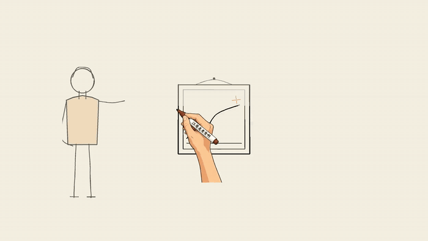
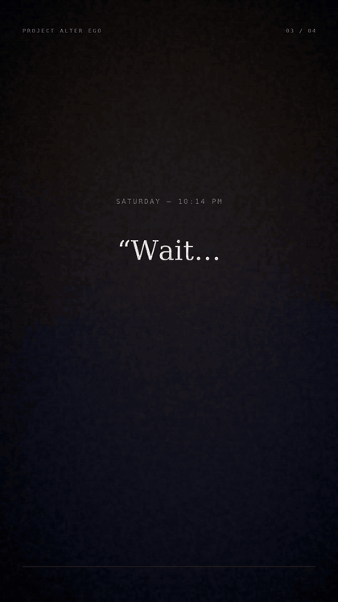

# Project Alter Ego — watch

Both videos are generated **from code on a 2-core CPU** — no GPU, no API key, no
model weights. Nothing to install to watch them.

---

## 1. Hand-drawn explainer · 1920×1080 · 47 s

Faceless doodle explainer on cream paper. The pen tracks every stroke, then colour
wipes in.

**▶ [Play the full video with sound](media/alter-ego-explainer.mp4)** (4 MB, click to play)

### Scene 1 — "You buy coffee. No hesitation."


### Scene 3 — "Wait… he actually made this?"



### Scene 5 — end card


---

## 2. Vertical teaser · 1080×1920 · 20 s

Kinetic typography cut for Shorts / Reels.

**▶ [Play the full video with sound](media/alter-ego-teaser.mp4)** (8.5 MB, click to play)



---

## How they're made

| | Hand-drawn explainer | Vertical teaser |
|---|---|---|
| Engine | [srt-whiteboard-animation](https://github.com/geeklee/srt-whiteboard-animation) (MIT, OpenCV + PyAV) | [MoviePy](https://github.com/Zulko/moviepy) (MIT) |
| Artwork | hand-coded in `video/whiteboard/doodle.py` | typography only |
| Render time | ~3 min | ~85 s |
| Source | [`video/whiteboard/`](video/whiteboard) | [`video/generate_teaser.py`](video/generate_teaser.py) |

`video/README.md` has the full survey of free video-gen repos and why the GPU-based
ones (Wan, LTX, Hunyuan, ComfyUI, OpenMontage) cannot run in this environment.

### Regenerate

```bash
pip install -r video/whiteboard/requirements.txt
python video/whiteboard/make_scenes.py     # redraw the frames
python video/whiteboard/render.py          # ink them in + score
```

### Credits

- `video/whiteboard/vendor/` — [geeklee/srt-whiteboard-animation](https://github.com/geeklee/srt-whiteboard-animation), MIT
- Fonts — Caveat & Patrick Hand, SIL Open Font License
